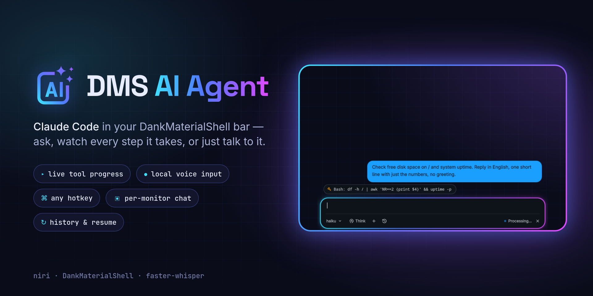
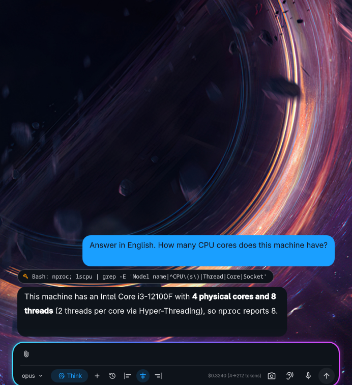
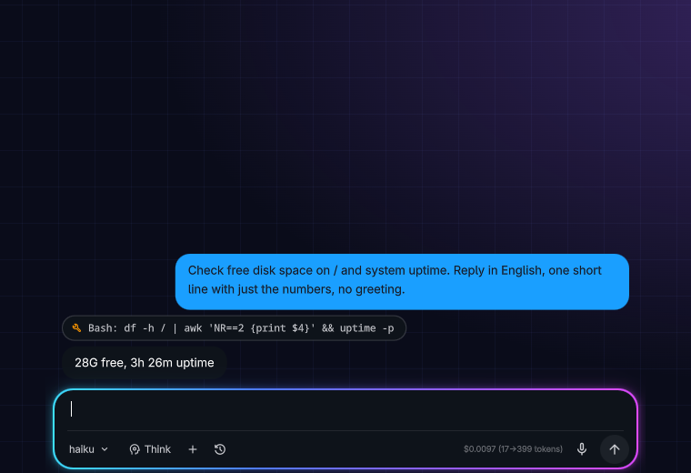

<p align="center">
  
</p>

<p align="center">
  <a href="LICENSE"></a>
  
  
  <a href="https://github.com/Francisdelca/dms-agent"></a>
</p>

**DMS AI Agent** is a desktop assistant for [DankMaterialShell](https://danklinux.com) powered by
[Claude Code](https://docs.claude.com/en/docs/claude-code). Click the pill in your bar (or hit a
hotkey), type or say what you need — "open Telegram on workspace 2", "how much disk space is left",
"find the PDFs I downloaded today" — and watch the agent do it, step by step.

It is a fork of [Francisdelca/dms-agent](https://github.com/Francisdelca/dms-agent) that fixes a few
bugs and adds the things that were missing for daily use. It is maintained independently: the
original has not changed since April 2026, and nothing is merged from it automatically.

## What's different from the original

| | Original | This fork |
|---|---|---|
| While the agent works | only "Processing..." | every tool call appears in the chat as it happens |
| Cancel | hid the request, Claude kept running in the background | really stops the agent |
| History | always empty (path hardcoded to the author's home) | lists and resumes your agent chats |
| Monitors | chat always opened on the first monitor | a pill on every bar, chat opens where you clicked |
| Hotkey | manual edit of the niri config | set in plugin settings, opens on the focused monitor |
| Voice | — | mic button, local Whisper (GPU or CPU), nothing leaves your machine |
| Transcribing others | — | a second button listens to the speakers, for the far side of a call your mic cannot hear |
| Showing the agent your screen | — | attach shots of the focused window to a message; the agent reads them |
| Attachments | — | paperclip opens the desktop's own file chooser; attach any file to a message |
| Replies | plain labels: nothing could be selected or copied | select with the mouse, or copy a whole reply as markdown or as plain text |
| Chat position | always bottom-centre | left edge, centre or right edge, remembered per monitor |
| Look | grey border | neon gradient rim, custom icon and label |
| Sessions | mixed with your other Claude Code sessions in `$HOME` | kept in their own project dir |
| Staying current | press Update when you remember to | optional notification when a newer version exists |

<p align="center">
  
  
</p>

## Requirements

- [DankMaterialShell](https://danklinux.com) ≥ 1.4 on **niri** (the chat itself also works on other
  compositors; the hotkey helper and "open on the focused monitor" need niri)
- [Claude Code](https://docs.claude.com/en/docs/claude-code) CLI, logged in (`claude` in `PATH`).
  **Your existing Claude Code login is what pays for this** — a Claude subscription if that is
  how you signed in. The plugin never asks for an API key and never calls the API itself.
- `python3`, `bash`; `git` for installing and the optional update notice (DMS itself installs plugins
  with it)
- Voice input: PipeWire (`pw-record`) and ~0.5–2 GB of disk for the Whisper model;
  an NVIDIA GPU makes it near-instant but is not required
- The "attach a screenshot of the active window" button needs niri (it is the only compositor
  here that can capture a single window); the picture is read through DMS's own clipboard, so
  `wl-clipboard` is not needed

## Install

```bash
curl -fsSL https://raw.githubusercontent.com/Cha1000000/dms-ai-agent/main/install.sh | bash
```

or from a checkout:

```bash
git clone https://github.com/Cha1000000/dms-ai-agent
cd dms-ai-agent && ./install.sh
```

The installer puts the plugin into `~/.config/DankMaterialShell/plugins/dmsAgent` (an existing copy
of the original plugin is moved aside, not deleted), creates a Python venv for voice input with the
CUDA libraries when an NVIDIA GPU is present, downloads the Whisper model and
restarts DMS (a hotkey is set only if you pass `--hotkey`). It tells you exactly which package to install if something is missing, and is safe to
run again to update.

| Option | Meaning |
|---|---|
| `--hotkey KEY` | niri hotkey for the chat, e.g. `Mod+Space`; none by default |
| `--no-voice` | skip the voice input setup |
| `--voice-venv PATH` | reuse an existing venv that already has `faster-whisper` |
| `--no-model` | don't pre-download the Whisper model (it downloads on first use) |

Then, in DMS:

1. **Settings → Plugins** → enable **DMS AI Agent**
2. **Settings → Bar** → add the **DMS AI Agent** widget to each bar where you want the pill

## Settings

**Settings → Plugins → DMS AI Agent**

| Setting | Default | |
|---|---|---|
| Model | `haiku` | `haiku`, `sonnet`, `opus` or a full id like `claude-opus-4-7`; the dropdown lists the same models as `/model` in the CLI (minus Fable), fetched from it |
| Effort | auto | `low`, `medium`, `high`, `xhigh`, `max` (`--effort`); also switchable in the chat toolbar, levels depend on the model |
| Per-session model | on | opening a chat from the history switches to the model and effort it was last used with (read from its transcript). A chat run on *auto* comes back with the level the CLI actually used |
| System Prompt | built-in | your own instructions for the agent |
| Pill Label | `Jarvis` | text next to the icon in the bar |
| Chat Hotkey (niri) | none | any niri key combo, e.g. `Mod+Space`; overrides an existing bind on that key; empty removes it |
| Message Text Size | `13px` | font size in the chat bubbles, 11–22; also `Ctrl` + wheel or `Ctrl` + `+` / `-` in the chat, `Ctrl+0` resets |
| Chat Height | `75%` | how much of the monitor's height the chat window takes, 40–95 |
| Liquid Glass | off | translucent bubbles with a highlighted edge and the background blurred behind each one; Background Transparency sets how dense the tint is; needs Blur enabled in DMS (otherwise the bubbles stay solid). Lniri draws a glass lens per bubble with a `dms:agent` layer-rule |
| Theme | `DMS Colors` | `DMS Colors`: follows your DMS theme; `Neon`: DMS surfaces with a blue neon accent and gradient rim; `Umbrella`, `Dark neutral`, `Light`: fixed palettes |
| Window Scale | `100%` | zooms the whole chat window (text, buttons, corners, spacing), 80–125%; Message Text Size is applied on top |
| Custom colors | off | overrides the key colors of the chosen theme: accent, panel and bubbles, text, borders, and the two ends of the neon gradient |
| Advanced: edit every color | off | one color per role of the theme; wins over the key colors. Turn a switch off to go back to the theme |
| Working directory | empty | where the agent starts, like `claude` run in a terminal there (that folder's `CLAUDE.md` and project settings apply). Empty = a private folder, `~/.local/state/dms-agent`. Each folder has its own chats and history; changing it starts a new chat. The folder button in the chat also lists the last 8 folders you applied, one click switches to one |
| Permissions | Ask first | *Ask first*: Allow / Deny dialog before each command or file change; *No confirmation*: runs everything immediately (`--dangerously-skip-permissions`) |
| Update notice | off | once per boot, check this repository and notify when a newer version exists; installs nothing |
| Whisper Model | `Auto` | `large-v3-turbo` on an NVIDIA GPU, `small` on CPU |
| Microphone | System default | dropdown of the capture devices PipeWire knows, under the names the audio settings show |
| Language | `auto` | speech recognition **and** interface language; a fixed code is also more accurate for short phrases |
| Warm up on open | off | load the speech model whenever the chat opens (~900 MB while it is open) so the first dictation is not clipped |
| Whisper venv | installer's | path to a venv with `faster-whisper` |

### Hotkey

No hotkey is set by default. When you enter one in the settings (or pass `--hotkey` to the
installer), the plugin writes it to `~/.config/niri/dms-ai-agent.kdl` and the installer adds an
include at the very end of `config.kdl`. To remove everything, clear the setting and delete that
line and file:

```kdl
include optional=true "dms-ai-agent.kdl"
```

Later binds override earlier ones with the same key, so the agent wins over a DMS default on that
key. A new value from the settings is checked with `niri validate` before it replaces the file —
a typo never breaks your running config. On other compositors, bind
`dms ipc call dmsAgent toggle` yourself.

### Voice input

Click the mic, speak, click again: the text is inserted at the cursor so you can fix it before
sending. `Esc` cancels. Recording continues in 2-minute chunks; each chunk is transcribed in the
background and its text is appended to the input field. Stop recording manually, or let it
continue as long as needed.

Speech is recognized locally by [faster-whisper](https://github.com/SYSTRAN/faster-whisper). The
model is loaded by a small background server on first use and unloaded after 10 idle minutes, so
the first phrase takes a couple of seconds and the next ones are near-instant. Turn on
**Warm up on open** in the settings to load the model whenever the chat opens instead (and stop it
when the chat closes). Logs:
`$XDG_RUNTIME_DIR/dms-agent-voice.log`.

### Transcribing what you hear

The button left of the mic records the **output** instead of the microphone —
whatever is playing on your speakers or headphones — and drops the transcript into the
input box the same way. It is meant for the other side of a call: in headphones your
microphone cannot hear them at all, and over speakers it hears them badly.

It attaches to the monitor of the current output, so switching from speakers to
headphones needs no configuration. Two caveats: everything playing is captured, notifications
and music included, and several speakers come out as one undivided block of text.
Your own voice is not in there — it goes to the microphone, not to the output.

Both buttons drive the same single recording, so while one is running the other is dimmed.

### Attaching files

The paperclip at the left of the input box opens the desktop's own file chooser —
the same dialog a browser shows, so it looks and behaves the way the rest of the
system does. Pick one file or several; each appears as a card above the input box,
images as thumbnails and everything else as a name. Click a card to open the file,
the cross to drop it.

Clicking a card opens the file the way the desktop would: with whatever is registered
for its type, and with the system's "open with" chooser when nothing is. Dropping a
card never deletes the file itself — only screenshots this plugin took are its own
to remove.

The portal is used where it exists, with zenity and kdialog behind it.

### Showing the agent your screen

The camera button shoots the focused window and attaches it to the message you are
about to send — useful when someone is walking you through code on a call. Attach as
many as you like; each appears as a thumbnail above the input box. Click a thumbnail to
open it full size, or its cross to drop it.

The chat is a layer, not a window, so it never takes focus away and never ends up in
the shot. niri always copies a screenshot to the clipboard, which is where the file is
taken from — so shots also stay in your clipboard history, and nothing is written to
your pictures folder. Attachments live in the runtime directory and disappear on reboot.

Two things worth knowing: the image is sent to the model like any other request, and it
is scaled down to roughly 1568px on its long side — small type in a 4K window may not
survive that, so a smaller window reads better than a full screen.

### Copying a reply

Message text is selectable: drag across it and press `Ctrl+C`, `Esc` clears the selection and puts
the cursor back in the input box. Hovering a bubble also reveals two buttons in its corner — **md**
copies what the agent actually sent, headings, bold and fenced code intact, and **Text** copies the
same without any markup. Your own messages get a single button.

### Language

Setting **Language** to a code translates the interface into it as well, not just
speech recognition — on `auto` the interface follows your locale. English and Russian
ship with the plugin; another language is a table in `i18n.js` and nothing else.

### Clearing history

Each row in the history list has a cross that deletes that conversation, and
*Clear all* in the corner removes every one of them. Both ask first: a transcript
is deleted from disk and there is no copy anywhere. Only agent conversations are
touched — an interactive Claude Code session started in the same directory is left
alone, and the id is verified rather than trusted.

### Session name

A chat renamed from the history list (or with `/rename` in the CLI) shows its name
in the bottom-right corner of the window, like the Claude Code CLI does.

### Where the chat opens

The three buttons next to *history* pin the chat to the **left edge**, the **centre** or the
**right edge** of the monitor. The open window moves as you press them, and the choice is kept for
each monitor separately — handy when one screen is wide and another is portrait.

Hold **Ctrl** and drag the chat with the left mouse button to put it anywhere along the bottom of
the screen. Near an edge or the centre it snaps to that preset. Drag past the edge of the monitor
and let go to move the chat to the neighbouring monitor (it dims while the drop would change
monitor). The chat window needs keyboard focus for Ctrl to register, which it normally has.

## Updating

Use **Update** in DMS (Settings → Plugins) or re-run `install.sh`. DMS updates plugins with
`git pull`, and this repository only ever moves forward, so updates are plain fast-forwards.

**Update notice** is off by default. When you turn it on in the plugin settings, once per
boot the plugin runs `git fetch` in its own directory and, if this repository has newer
commits, shows a notification. It changes nothing: no merge, no restart. Updating stays
with DMS (Settings → Plugins → Update).

If the chat still behaves like the old version afterwards, restart the shell —
`systemctl --user restart dms.service`. Reloading the plugin alone refreshes the bar widget while
the chat panel stays in memory with the QML it was built from.

## Good to know

- **Permissions.** By default the agent asks first: before it runs a command or changes a file the
  chat shows an **Allow / Deny** dialog (`Enter` allows, `Esc` denies) and the agent waits. In the
  settings you can switch **Permissions** to *No confirmation*; then Claude Code runs with
  `--dangerously-skip-permissions` and the agent executes commands **without asking**, with
  unrestricted shell access as your user. That makes "open X, move it to workspace 2" instant —
  keep it in mind. Prompts, window lists and attachments go to Anthropic in either mode.
- **Billing follows your Claude Code login, not this plugin.** It shells out to the `claude` you
  already have, so whatever that is authenticated with — a subscription, or an API key if you set
  one up — is what answers. There is no key to enter here and no separate account. The cost shown
  under the input box is what the CLI reports for the request; on a subscription it is an
  indication of usage rather than a charge.
- Agent sessions live in their own Claude Code project (working dir
  `~/.local/state/dms-agent`), separate from sessions you start in your home directory.
- The chat panel is shown on one monitor at a time; the hotkey toggles it on the focused one.

## Credits

Original plugin by **[Francis](https://github.com/Francisdelca)** —
[Francisdelca/dms-agent](https://github.com/Francisdelca/dms-agent). This fork is maintained by
[Vladimir Mileshko](https://github.com/Cha1000000). Much of the fork was written together with
Claude Code.

[MIT](LICENSE)
